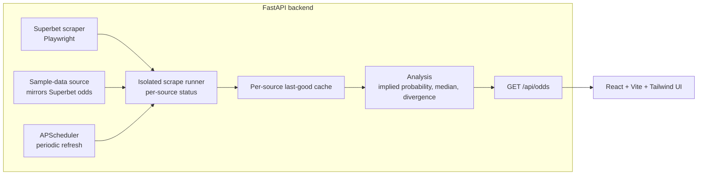

# ComparaCote.ro

A football 1X2 odds comparison tool. It scrapes pre-match odds, matches the same
fixture across sources, converts every price to an implied probability
(`p = 1 / odd`), and flags outcomes where one source is noticeably more generous
than the median of all sources.

> **Note:** the hosted demo is currently offline. Run the project locally with the
> steps below.

## What it does

- Scrapes today's football 1X2 odds from Superbet with Playwright.
- Pairs the same fixture across sources using fuzzy team-name matching.
- Compares each source's implied probability with the cross-source median and
  flags outcomes that beat it by more than 4% (`VALUE_THRESHOLD`).
- Splits matches into a "main" tier and an "obscure" tier (reserve, women's and
  youth teams, detected from the team name).
- Shows, per bookmaker, the five matches where it is most generous.
- Reports per-source freshness, so the UI can warn when data is stale or a
  refresh failed.

## Architecture



| Path | Role |
| --- | --- |
| `backend/scrapers/superbet.py` | Live scraper |
| `backend/scrapers/sample_data.py` | Clearly labeled sample-data source |
| `backend/analysis/calculator.py` | Isolation wrapper, matching, analysis, best odds per bookmaker |
| `backend/api/main.py` | FastAPI app, in-memory cache, scheduler |
| `frontend/` | React single-page UI |

## Tech stack

- **Backend:** Python, FastAPI, Playwright, asyncio, APScheduler
- **Frontend:** React, Vite, Tailwind CSS
- **Packaging:** Dockerfile for the backend (Chromium runtime)

## Local setup

### Windows (PowerShell)

```powershell
# Backend
cd backend
py -m pip install -r requirements.txt
py -m playwright install chromium
py -m uvicorn api.main:app --reload

# Frontend (second terminal)
cd frontend
npm install
npm run dev
```

### Linux / macOS

```bash
# Backend
cd backend
python3 -m pip install -r requirements.txt
python3 -m playwright install chromium
python3 -m uvicorn api.main:app --reload

# Frontend (second terminal)
cd frontend
npm install
npm run dev
```

The frontend calls `http://localhost:8000` when `VITE_API_URL` is set to it (see
`frontend/.env.example`).

The first scrape takes a couple of minutes. Until it finishes, the API request
waits for it.

## Superbet-only mode

Only Superbet is scraped live. The second source in the comparison is
**sample data**: `scrapers/sample_data.py` generates it by copying the Superbet
odds of the same run with small random changes, so the comparison always has
something to work with. It is labeled "Sample data" in the API (`sources.sample`
has `is_sample: true`) and in the UI.

Because the sample source is derived from Superbet, the values it produces are
not real market signals. If the Superbet scrape fails, the sample source is empty
too, and the API keeps serving the last good data with a stale/failed marker.

**Single-source mode.** Sample data does not count as a source for comparison.
When fewer than two real sources have data (always the case in this repository),
the API returns `comparison_mode: "single_source"` and the "best odds" tab lists
the real source's own matches with their 1X2 odds, under a notice that
cross-bookmaker comparison needs at least two sources. In this mode
`best_odds_per_bookmaker` is empty and the matches are in `single_source.matches`
(fabricated filler fixtures are excluded). With two or more real sources the
response is `comparison_mode: "multi_source"` and the per-bookmaker ranking is
returned as before.

## The second bookmaker

The scraper for the second bookmaker is **not part of this repository**. The
public version uses the clearly labeled sample data described above. The
architecture supports more sources: add a scraper that returns a list of matches
and register it in `SOURCES` in `calculator.py`.

## Development

`SIMULATE_FAILED_SOURCES` (off by default) makes the named sources report a
failed refresh, to try the stale/failed banners without breaking a real scrape.
It takes comma-separated source names (`superbet`, `sample`), is read on every
refresh, and a source that already has good data keeps serving it. A simulated
failure shows up in `sources.<name>` with `ok_last_run: false` and
`error: "simulated failure"`. The backend does not read `.env` files, so set it
in the shell before starting the server.

```powershell
# Windows PowerShell
$env:SIMULATE_FAILED_SOURCES = "sample"
py -m uvicorn api.main:app --reload
```

```bash
# Linux / macOS
SIMULATE_FAILED_SOURCES=sample python3 -m uvicorn api.main:app --reload
```

## Design decisions

- **Async scraping pipeline.** Scrapers are `async` Playwright functions. The API
  runs the scrape in a worker thread with its own event loop, so the browser work
  does not block the web server.
- **Isolation per source.** Each source is scraped inside its own try/except. A
  crash, or a result with fewer than 5 matches (treated as a likely page
  change), marks that source as failed without affecting the others.
- **Caching and stale-data handling.** The last response lives in memory with a
  30-minute TTL. A background job refreshes every 25 minutes. Each source keeps
  its last good matches, so a failed scrape does not wipe good data. A source is
  reported stale once its last success is older than 45 minutes.
- **Honest freshness.** `generated_at` only advances when at least one source
  refreshed successfully, and each source reports `last_success_at`. The UI shows
  a banner for every stale or failed source with its last successful update time,
  and hides the "updated X minutes ago" line when nothing has ever succeeded.
- **Best odds computed per bookmaker.** One bookmaker's list is built only from
  its own data, so an error for one source does not empty the other's.

## Known limitations

- Football and the 1X2 market only.
- The cache is in memory, so it is lost on restart and not shared across
  processes. There is no database.
- Scraping depends on the bookmaker's page structure and can break when it
  changes.
- Divergence needs at least two real sources. With one, the best-odds tab shows
  that source's odds without a value ranking, and the comparison tabs rely on
  sample data.
- Fixture matching is heuristic (fuzzy team names) and can mispair fixtures.
- Odds above 10.0 are skipped to avoid meaningless divergences.
- There are no automated tests in this repository.

## Screenshots

Placeholders; add images under `docs/screenshots/`.

| View | File |
| --- | --- |
| Main leagues comparison | `docs/screenshots/comparison-main.png` |
| Other leagues | `docs/screenshots/comparison-other.png` |
| Best odds per bookmaker | `docs/screenshots/best-odds.png` |
| Stale-source banner | `docs/screenshots/stale-banner.png` |

## Disclaimer

This is an educational portfolio project. It is not affiliated with any
bookmaker and does not provide betting advice. Odds shown may be outdated or
wrong. Gambling is for adults (18+); play responsibly.
